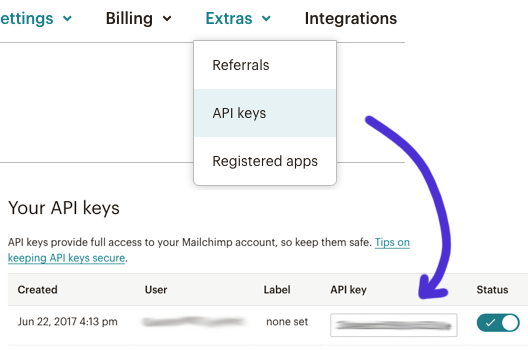
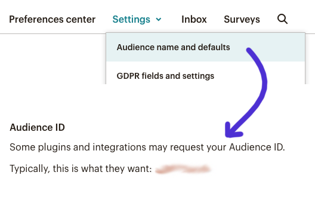
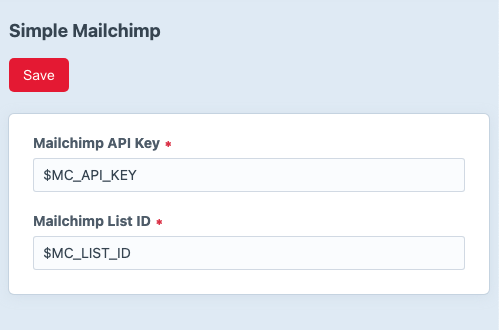

# Simple Mailchimp for Craft CMS

A minimal Craft CMS plugin to connect subscription forms directly to Mailchimp.

---

## Requirements

This plugin requires:
- **Craft CMS**: `^5.0.0`
- **PHP**: `^8.2 || ^8.3 || ^8.4 || ^8.5`

For older Craft versions:
- Craft 4: `"leowebguy/simple-mailchimp": "^2.0"`
- Craft 3: `"leowebguy/simple-mailchimp": "^1.0.4"`

---

## Installation

You can install this plugin from the Plugin Store or via Composer:

```bash
composer require leowebguy/simple-mailchimp -w
```

Then in your Craft Control Panel, go to **Settings → Plugins → Simple Mailchimp** and click **Install** (or run `php craft plugin/install simple-mailchimp`).

---

## Credentials & Configuration

Gather the necessary info from Mailchimp:

1. **API Key (`MC_API_KEY`)**:
   - Go to [Mailchimp Account API Keys](https://admin.mailchimp.com/account/api/) and generate an API key.
   - 

2. **Audience ID (`MC_LIST_ID`)**:
   - Go to [Mailchimp Audience](https://admin.mailchimp.com/lists) → Select Audience → Settings → Audience name and defaults → Audience ID.
   - 

3. Add your credentials in **Settings → Simple Mailchimp**:
   - 

You can use environment variables in your `.env` file and reference them in the plugin settings (e.g. `$MC_API_KEY` and `$MC_LIST_ID`):

```dotenv
# Mailchimp
MC_API_KEY=xxx12345x1234x123xxx123xxxxx123xx-us14
MC_LIST_ID=xxx1234xx1234
```

---

## Usage

Create your newsletter form template:

```twig
<form method="post" id="mailchimp">
    {{ csrfInput() }}
    <input type="hidden" name="tags" value="Newsletter,Website">
    <input type="text" name="name" placeholder="Your Name">
    <input type="email" name="email" required placeholder="Your Email">
    <button type="submit">Subscribe</button>
</form>
```

> The only required field is `email`. Optional fields include `name`, `tags`, and `merge_fields`.

### JavaScript Submission Examples

#### Vanilla JavaScript (Fetch API)

```js
const form = document.querySelector('#mailchimp');

if (form) {
    form.addEventListener('submit', (e) => {
        e.preventDefault();
        fetch('/mailchimp/send', {
            method: 'POST',
            body: new FormData(form)
        })
        .then((response) => response.json())
        .then((data) => {
            alert(data.msg);
        })
        .catch((error) => {
            console.error(error);
        });
    });
}
```

#### jQuery

```js
$('form#mailchimp').on('submit', function (e) {
    e.preventDefault();
    $.post({
        url: '/mailchimp/send',
        data: $(this).serialize(),
        success: function (data) {
            alert(data.msg);
        },
        error: function (error) {
            console.error(error);
        }
    });
});
```

---

## Development & Testing

Run code quality checks and static analysis tools locally:

```bash
# Validate composer configuration
composer validate --no-plugins

# Static analysis (PHPStan Level 8)
composer stan

# Code style check (Laravel Pint / PSR-12)
composer pint-test

# Code style fixer
composer pint
```
